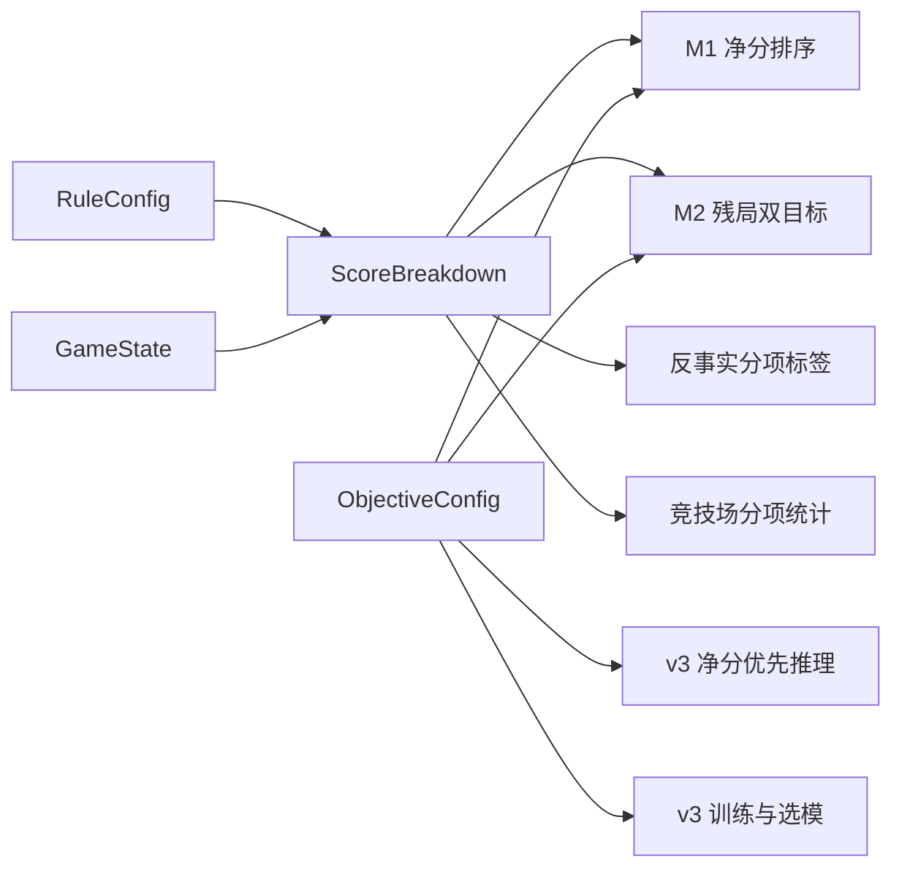

## 用户需求

修复当前策略“净分口径下不使用春天和炸弹收益”的问题，并将决策目标统一为**净分优先、胜率相对 M2 不显著退化**。

## 核心问题

- M1 只优化 `min_steps`、`burn_cost`、`keep_lead_prob`，没有春天潜力、炸弹期望和净分目标。
- M2 只有总剩牌 ≤8 的精确残局使用终局净分，中局仍沿用 M1；PIMC 终局只按胜负估值。
- 当前 v3 策略先取胜率最高，只有胜率差小于 `1e-6` 时才用净分破平，净分头几乎无效。
- 竞技场只输出总净分，没有春天、炸弹分项，也没有对应 paired CI。
- `src/evaluate/spring_evaluator.py` 是旧 SB3 环境工具，未接入当前引擎。

## 修改范围

全链路改造：

- 统一基础分、春天、炸弹的计分拆解与效用函数。
- 改造 M1、M2、PIMC 和 v3 推理。
- 扩展反事实数据标签、训练损失与 checkpoint 选择。
- 扩展竞技场的分项统计、配对置信区间和晋级门槛。
- 保留现有 `policy_v3_r1/r2`，不覆盖 `policy_v3.pt`，不改变 API 默认 M2。

## 验收口径

- 主指标：冻结测试集上相对 M2 的 paired 净分差，95% CI 下界 >0。
- 约束：胜率相对 M2 不显著退化，默认非劣边界为 -1pp。
- 必须分别报告部分春天、双春天、炸弹得分和基础分贡献。
- 继续使用 6 座位排列、按 deal 聚类的 paired bootstrap，不使用随机对手。
- 新模型必须使用未参与本轮调参的新冻结 test deals，P99 ≤300ms 才允许部署。


## 技术栈

- 语言与运行时：现有 Python 3.13、NumPy、PyTorch 2.14.1+cu130。
- 运行环境：`E:\ComfyUI\ComfyUI-0.43.0\python_embeded\python.exe`。
- 不新增第三方依赖，复用 `fastrun` 引擎、`M1Policy`、残局搜索和 v3 策略网。

## 实现方案

### 1. 建立唯一计分拆解

新增 `ScoreBreakdown`，从 `hands/tricks/bombs/winner` 计算：

- `base`：对手剩余牌基础分，包含剩 1 张保本规则。
- `spring`：每个零出牌对手 30 分，必须区分部分春天和双春天。
- `bomb`：`state.bombs[player]` 的累计炸弹分。
- `total = base + spring + bomb`。

`GameState._final_scores` 改为调用统一函数，杜绝规则、训练标签和评估各自重算导致口径漂移。

### 2. 统一目标函数

新增独立 `ObjectiveConfig`，默认：

- 决策模式：净分优先，胜率守卫。
- `win_guard = 0.01`：v3 只在胜率不低于候选最高值 1pp 的动作中选择净分最高者。
- `spring_weight`、`bomb_weight` 和 M1 的额外步数惩罚可在验证集校准。
- 保留 `win_primary` 模式用于消融和回滚，不改变规则哈希。

### 3. 规则策略改造

**M1**

- 不再只保留最大 progress 的候选；候选池至少包含：
  - 原有最高 progress 候选；
  - 所有炸弹动作；
  - 能保持对手零出牌状态的春天候选。
- 增加：
  - `bomb_delta = child.bombs[me] - state.bombs[me]`，精确计算立即炸弹分。
  - `spring_potential`：基于对手零出牌数、自己剩余手数、`keep_lead_prob` 估算保住春天的价值，单对手 30 分、双对手 60 分。
  - 净分代理：基础进度收益 + 炸弹立即收益 + 春天潜力 - 控制权损失。
- 增加胜率可行性守卫，避免为了 30 分春天额外拆牌导致胜率明显下降。
- 热路径不增加逐候选 MC，保持 O(K) 候选评估。

**M2**

- 残局搜索的值从单一净分扩展为 `(win_rate, score)`。
- 动作选择改为：在胜率不低于最佳值 `win_guard` 的动作中取净分最高者。
- 终局仍使用统一 `ScoreBreakdown`。
- 搜索预算耗尽时，`_eval` 增加春天潜力和炸弹分估计，不再只看 `min_steps`。
- 当对手仍为零出牌且自己已接近走完时，允许对春天关键局面提前进入评分搜索，避免总剩牌 ≤8 的入口过晚。
- PIMC 终局改为使用实际净分/统一效用，不再只返回 ±200。

### 4. v3 特征与推理

特征版本升级到 v4，动作版本同步升级：

- 状态新增：相对座位的对手零出牌标记、双春天存活、累计炸弹分、可兑现基础分代理。
- 修正 `tricks`、`bombs` 按绝对座位编码的问题，统一为 `p/nxt/prv` 相对顺序。
- 动作新增：立即炸弹分差、对手零出牌数、完成后春天价值、`finish_now`、保权后是否仍能维持春天。
- `PolicyAgent` 改为净分优先：取净分最高且胜率不低于最高胜率减 `win_guard` 的动作，不再用 `1e-6` 胜率破平。
- checkpoint 增加 `objective_version` 和 `win_guard`，旧 v3 特征 checkpoint 直接拒绝加载。

### 5. 数据与训练

- 反事实标签除 win/score 外，新增：
  - `base_score`
  - `spring_score`
  - `bomb_score`
  - `spring_opponents`
  - `full_spring`
- 教师 rollout 终局通过统一 `ScoreBreakdown` 生成标签。
- 主损失改为净分排序损失；胜率作为辅助约束或低权重正则。
- checkpoint 选择从 `regret_win + 0.25 * regret_score` 改为：
  - 先满足验证集胜率 regret 不超过基线容差；
  - 再选择净分 regret 最低的模型。
- 数据分片继续按 train/val/test 物理隔离并携带 v4 元数据。

### 6. 评估与晋级

- `GameRecord` 增加胜率、总净分、基础分、春天分、炸弹分、春天次数、双春天、hero/对手炸弹次数。
- `MatchReport` 输出分项均值；`paired_bootstrap_diff` 返回所有分项的配对 CI。
- `arena_policy` 输出：
  - 总净分、基础分、春天分、炸弹分；
  - 部分春天率、双春天率、炸弹局占比；
  - 分项 CI 和 P50/P95/P99。
- 新门槛：
  - `score_ci_lower > 0`；
  - `win_ci_lower > -0.01`；
  - 强对手池无显著退化；
  - 不再允许“仅胜率提升、净分不降”直接通过。
- 新建当前引擎的 `tools/eval_score_components.py`，替代旧 SB3 `spring_evaluator`；旧文件保留为 legacy，不再作为评估入口。

### 7. 性能与兼容

- M1 只增加少量候选和 O(1) 公式，不改变平均合法动作数。
- M2 残局只扩展值结构，不增加根动作数；春天提前搜索必须设置节点预算。
- v3 增加约 10~15 维特征，推理延迟影响可忽略。
- 旧 v3 checkpoint 保留但拒绝加载；`models/policy_v3_r1*`、`policy_v3_r2*` 不删除、不覆盖。
- 只有通过新门槛的模型才允许复制为 `models/policy_v3.pt`。

## 架构关系



## 目录与文件

```text
src/eval/score_ev.py              # [NEW] ScoreBreakdown、春天潜力、炸弹分差和净分代理
src/eval/objective.py             # [NEW] ObjectiveConfig、净分优先与胜率守卫
src/fastrun/state.py              # [MODIFY] 终局计分委托统一 breakdown
src/eval/policy_m1.py             # [MODIFY] 扩展候选池，加入春天/炸弹净分项和胜率守卫
src/search/endgame.py             # [MODIFY] 双目标值、净分选择、近似叶子估值
src/search/pimc.py                # [MODIFY] 终局和动作选择使用净分效用
src/arena/agents.py               # [MODIFY] M2 配置、PolicyAgent 净分优先和 win_guard
src/net/encode_v3.py              # [MODIFY] v4 状态/动作特征，修正相对座位编码
src/net/model.py                  # [MODIFY] objective_version 元数据与兼容校验
src/arena/match.py                # [MODIFY] GameRecord 分项、分项聚合和 paired bootstrap
tools/gen_counterfactual_data.py  # [MODIFY] 保存春天/炸弹/基础分标签，版本升 v4
tools/train_policy.py             # [MODIFY] 净分主损失、胜率约束和净分 regret 选模
tools/arena_policy.py             # [MODIFY] 分项报表、净分主门槛和非劣约束
tools/eval_score_components.py    # [NEW] 当前 fastrun 引擎的春天/炸弹专项评估
tests/test_score_components.py    # [NEW] 基础分、保本、30/60 春天、炸弹及反压计分测试
tests/test_score_objective.py     # [NEW] M1/M2/v3 净分优先、胜率守卫和候选覆盖测试
tests/test_arena_components.py    # [NEW] 分项统计、paired CI 和新晋级门槛测试
```

## 关键接口

```python
@dataclass(frozen=True)
class ScoreBreakdown:
    base: int
    spring: int
    bomb: int
    total: int
    spring_opponents: int
    full_spring: bool


@dataclass(frozen=True)
class ObjectiveConfig:
    mode: str = "score_primary"
    win_guard: float = 0.01
    spring_weight: float = 1.0
    bomb_weight: float = 1.0
    max_extra_steps: int = 1
```

## 验证与消融

- 计分单测：保本剩 1 张、单对手春天 +30、双春天 +60、炸弹 +20/-10/-10、炸弹反压退款。
- M1 消融：仅春天项、仅炸弹项、两项同时、加胜率守卫。
- M2 消融：净分主目标、胜率主目标、胜率守卫阈值、春天提前搜索。
- v3 消融：净分优先推理、win_guard、分项标签、v4 特征。
- 对局验收使用新冻结 test deals，先对 M2/Greedy 建基线，再训练 3 个种子。
- 主结论必须同时满足净分 CI 下界 >0、胜率不低于 M2 超过 1pp、强对手池不退化、P99 ≤300ms。

